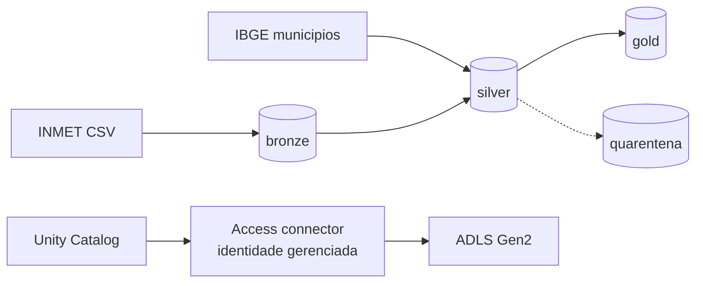

# lakehouse-azure-iac

[](https://github.com/amanda-martins-data/lakehouse-azure-iac/actions/workflows/ci.yml)

Lakehouse medallion no Azure, com toda a infraestrutura em Terraform:
ADLS Gen2, Azure Databricks com Unity Catalog, identidade gerenciada,
Key Vault, auditoria no Log Analytics e alerta de orcamento. O pipeline
em PySpark + Delta Lake leva os dados horarios do INMET de bronze a gold,
com o municipio IBGE resolvido pela logica do
[projeto 13](https://github.com/amanda-martins-data/pipeline-multi-fonte-dados-publicos) (incluindo a
quarentena do que nao resolve com seguranca).

## O que foi executado (evidencia)

Este repositorio separa o que o codigo **descreve** do que ja foi
**executado**. Detalhes em [ADR 0016](decisions/0016-evidencia-sem-provisionar.md).

| Nivel | O que prova | Status |
|---|---|---|
| 1 - CI | `fmt`, `validate` das duas raizes, `tflint` (regras azurerm), `checkov`; pipeline testado em Delta e em Parquet | a cada push, ver badge acima |
| 1b - dados reais | pipeline inteiro sobre arquivos reais do INMET e a tabela do IBGE ([workflow manual](.github/workflows/real-data.yml)) | resultado no resumo da execucao |
| 2 - plan | plano da plataforma contra uma assinatura real | ainda nao executado |
| 3 - apply/destroy da plataforma | recursos criados e destruidos no Azure | ainda nao executado |
| 4 - ponta a ponta no Azure | catalogo, job e cluster rodando | ainda nao executado |

## Arquitetura



Diagrama completo, tabelas e regras de escrita em
[docs/arquitetura.md](docs/arquitetura.md).

## Decisoes

| ADR | Decisao |
|---|---|
| [0013](decisions/0013-delta-lake-como-formato.md) | Delta Lake em todas as camadas |
| [0014](decisions/0014-unity-catalog-com-external-locations.md) | Unity Catalog com external locations, sem mounts |
| [0015](decisions/0015-identidade-gerenciada.md) | Identidade gerenciada, nenhuma chave de storage |
| [0016](decisions/0016-evidencia-sem-provisionar.md) | Duas raizes de Terraform e niveis de evidencia |
| [0017](decisions/0017-sem-vnet-injection.md) | Isolamento por identidade, sem VNet injection nesta versao |

## O pipeline

| Etapa | Entrada | Saida | Garantia |
|---|---|---|---|
| `jobs/bronze_ingest.py` | CSVs do INMET (latin-1, `;`, virgula decimal) | `bronze.inmet_horario` | reprocessar um arquivo substitui as linhas dele; arquivo corrompido vai para `arquivos_rejeitados` sem derrubar o lote |
| `jobs/silver_conform.py` | bronze + municipios IBGE | `silver.medicoes_horarias`, `silver.quarentena` | `-9999` e vazio viram NULL; duplicatas removidas; estacao sem municipio confiavel vai para quarentena com o motivo |
| `jobs/gold_metrics.py` | silver | `gold.clima_diario_municipio` | `MERGE` por (`codigo_ibge`, `data`); rodar de novo nao duplica |

Os testes em [`tests/`](tests) cobrem esses comportamentos com arquivos
sinteticos no formato real do INMET (cabecalho de 8 linhas, coluna
fantasma, sentinela `-9999`, hora invalida, linha duplicada, uma estacao
da PB com nome igual a um municipio do RJ).

### Rodar localmente

Requer Python 3.11 e Java 17.

```bash
pip install -r requirements-dev.txt
pytest -q

# pipeline completo sobre os fixtures
for job in bronze_ingest silver_conform gold_metrics; do
  python jobs/$job.py --input tests/fixtures/inmet \
    --reference tests/fixtures/municipios_ibge_amostra.csv --lake lake
done
```

Sem acesso ao Maven para os jars do Delta, use `LAKEHOUSE_FORMAT=parquet`
(so para teste; ver ADR 0013).

## A infraestrutura

```
infra/
  modules/
    storage/      ADLS Gen2: HNS, sem chave compartilhada, soft delete, ciclo de vida
    databricks/   workspace Premium (secure cluster connectivity) + access connector
    security/     Key Vault (RBAC, purge protection) + Log Analytics + diagnosticos
  envs/dev/
    platform/     resource group, modulos, papeis RBAC, budget
    catalog/      storage credential, external locations, catalogo, schemas, grants, job
```

### Provisionar (niveis 3 e 4)

```bash
az login
cp infra/envs/dev/platform/terraform.tfvars.example infra/envs/dev/platform/terraform.tfvars
terraform -chdir=infra/envs/dev/platform init
terraform -chdir=infra/envs/dev/platform apply

# com as saidas da plataforma
cp infra/envs/dev/catalog/terraform.tfvars.example infra/envs/dev/catalog/terraform.tfvars
terraform -chdir=infra/envs/dev/catalog init
terraform -chdir=infra/envs/dev/catalog apply
```

O catalogo exige que o workspace tenha um metastore do Unity Catalog
(workspaces novos costumam receber o da regiao automaticamente) e que os
grupos `data-engineers` e `data-analysts` existam na conta do Databricks.

O job nasce com o agendamento pausado. Antes de rodar, copie os CSVs do
INMET para `bronze/landing/inmet/` e a tabela do IBGE para
`bronze/landing/ibge/municipios.csv`.

Custo e como destruir tudo: [docs/custo.md](docs/custo.md).

## Fontes dos dados

- INMET - dados historicos horarios das estacoes automaticas
  (portal.inmet.gov.br/dadoshistoricos).
- Municipios com codigo IBGE:
  [kelvins/municipios-brasileiros](https://github.com/kelvins/municipios-brasileiros).
