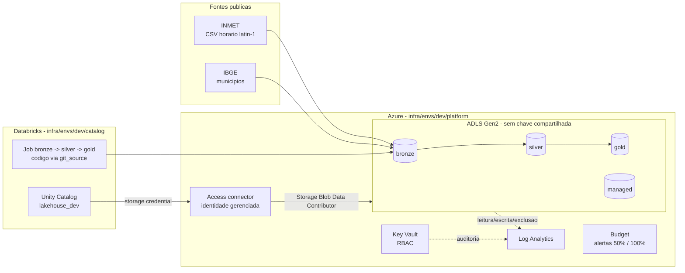

# Arquitetura

## Camadas

| Camada | Tabela | Regra de escrita | Conteudo |
|---|---|---|---|
| bronze | `inmet_horario` | substitui as linhas do arquivo reprocessado (`replaceWhere` por `_source_id`) | uma linha por medicao, valores como texto num `MAP<string,string>` com o nome original da coluna |
| bronze | `arquivos_rejeitados` | idem | arquivos que nao parseiam, com o erro |
| silver | `medicoes_horarias` | recalculada a partir da bronze | tipada, sem duplicatas, com `codigo_ibge` e a estrategia usada para resolver o municipio |
| silver | `quarentena` | recalculada | linhas que nao entram na silver e o motivo (`data_ou_hora_invalida`, `municipio_nao_encontrado`, `municipio_ambiguo`) |
| gold | `clima_diario_municipio` | `MERGE` por (`codigo_ibge`, `data`) | precipitacao total, temperatura media/max/min, umidade media, horas observadas |

## Por que cada coisa esta onde esta

- **Duas raizes de Terraform**: o provider do Databricks so planeja com
  um workspace existente (ADR 0016).
- **Identidade gerenciada**: nenhuma chave de storage no codigo ou no
  Key Vault (ADR 0015).
- **External locations por camada**: o grant e por schema/camada, e o
  acesso fica auditado no Unity Catalog (ADR 0014).
- **Isolamento por identidade, nao por rede**: decisao consciente para
  dado publico, com o caminho para producao descrito (ADR 0017).

## Datas

As horas do INMET sao UTC, e a `data` da gold tambem e a data UTC. Um
dia em America/Sao_Paulo comeca as 03:00 UTC; quem precisar do dia
local deve agregar a partir da silver.
